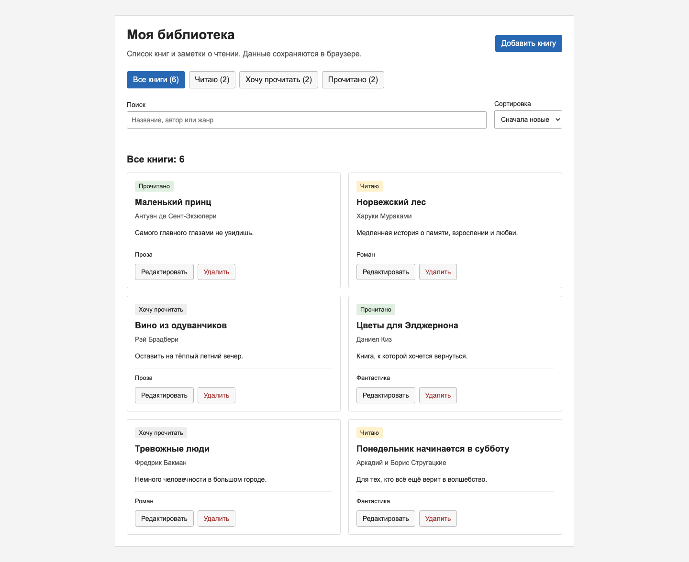
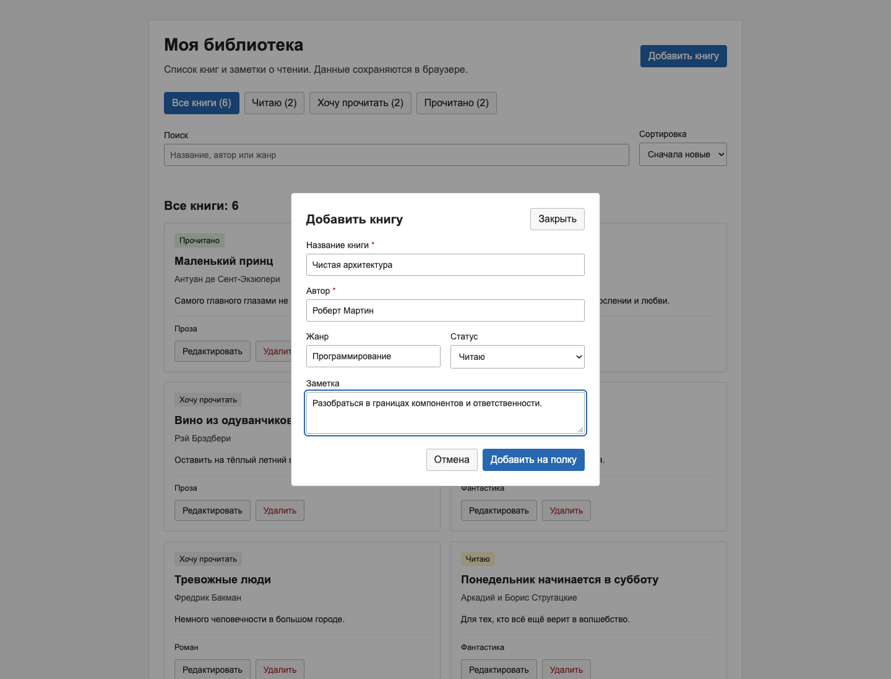
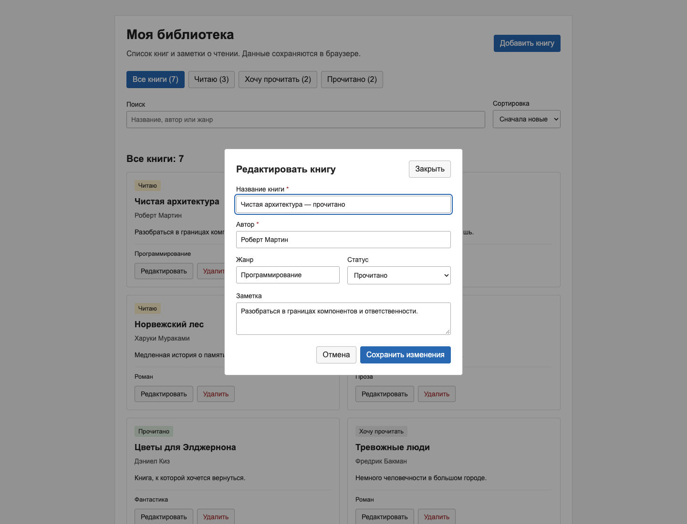
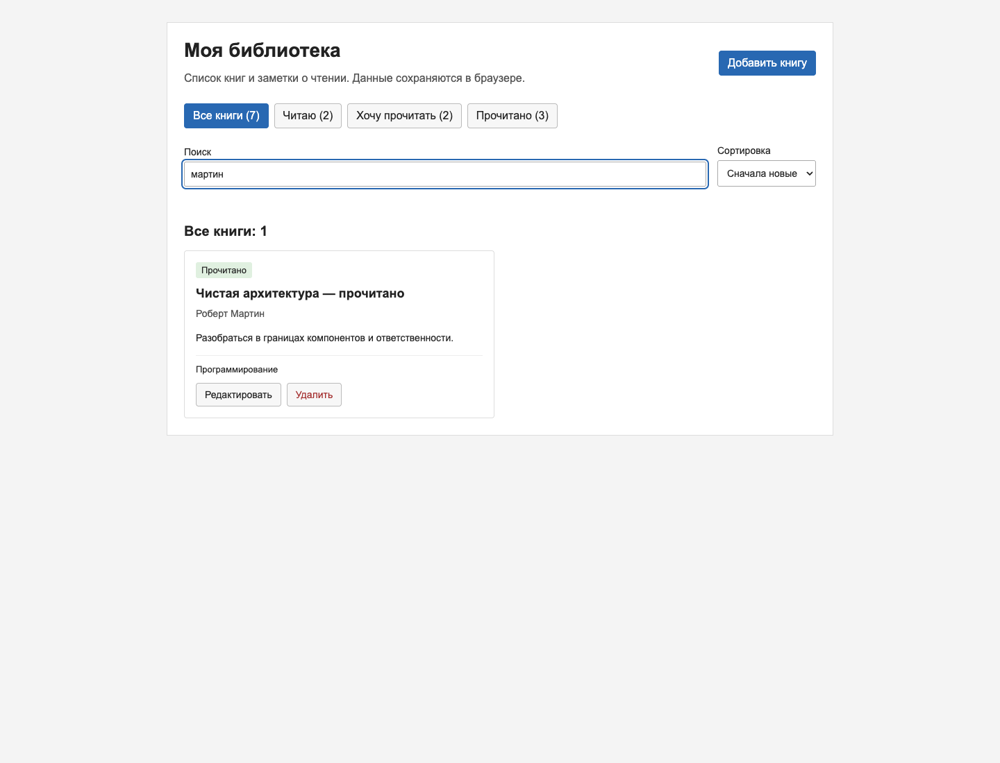
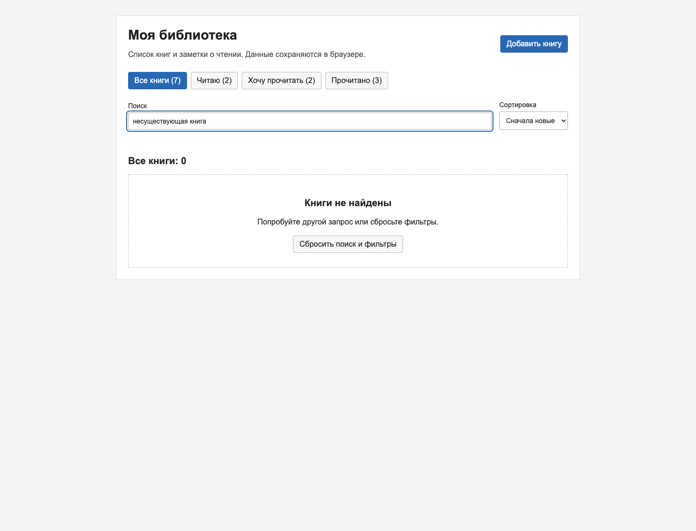
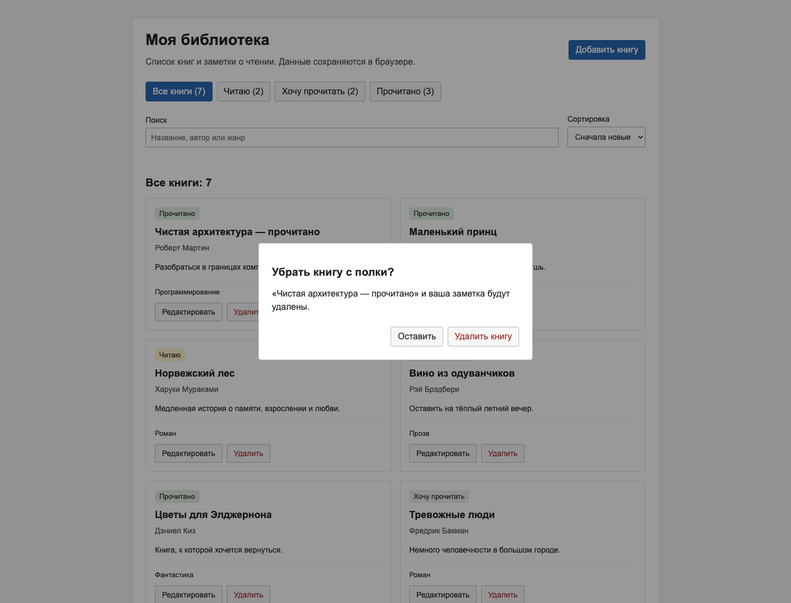
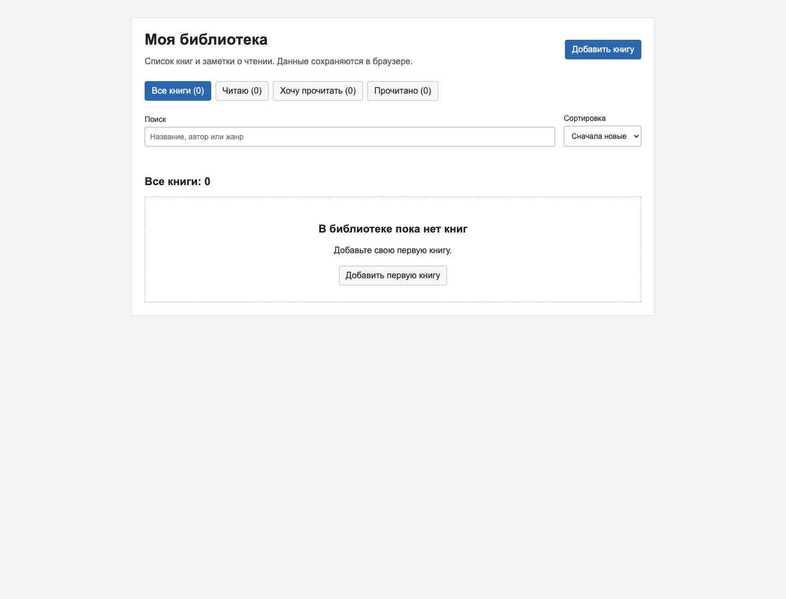
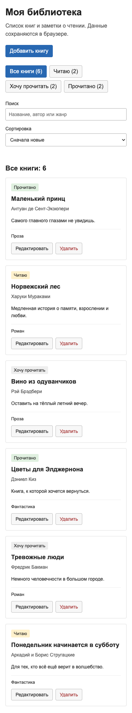

# Моя библиотека

Личная книжная полка на React + TypeScript + Vite. Можно собирать книги, планировать чтение и сохранять короткие впечатления. Сервер и регистрация не нужны: все записи остаются в браузере.

## Запуск через Docker

```bash
docker compose up --build -d
```

Откройте http://localhost:8080. При первой сборке нужен интернет:
Docker скачает базовые образы и зависимости, соберёт приложение и запустит
Nginx для раздачи готовых файлов.

Остановка и повторный запуск уже созданного контейнера:

```bash
docker compose stop
docker compose start
```

После изменения исходников снова выполните `docker compose up --build -d`.
Удалить контейнер можно командой `docker compose down`.

Собрать и запустить образ без Compose можно так:

```bash
docker build -t bookroom:local .
docker run --rm -p 127.0.0.1:8080:80 bookroom:local
```

## Запуск без Docker

Нужны **Node.js 22.12+** (или Node.js 24 LTS) и **pnpm 11.25.0**. Если pnpm ещё нет, установите его через `npm install -g pnpm@11.25.0`.

В терминале в папке проекта:

```bash
pnpm install --frozen-lockfile
pnpm dev
```

Откройте адрес, напечатанный Vite: обычно http://127.0.0.1:5173. Если порт занят, Vite предложит другой.

Сборка для публикации и её просмотр:

```bash
pnpm build
pnpm preview
```

Сборка появится в `dist/`, предпросмотр обычно доступен по http://127.0.0.1:4173. Для повторного открытия своей полки используйте тот же браузер и адрес: `localhost` и `127.0.0.1`, разные порты и профили имеют разные хранилища.

## Что умеет приложение

| Сценарий        | Как проверить                                                                                                                                                                                        |
| --------------- | ---------------------------------------------------------------------------------------------------------------------------------------------------------------------------------------------------- |
| Просмотр        | При первом открытии отображаются шесть демонстрационных книг, статусы, авторы, жанры и заметки. Количество книг отображается в кнопках фильтра.                                                      |
| Добавление      | «Добавить книгу» → заполнить название и автора → выбрать статус, при желании жанр и заметку → «Добавить на полку». Книга появляется первой, поиск и фильтр сбрасываются, чтобы запись была видна.    |
| Редактирование  | Кнопка «Редактировать» на карточке → изменить поля → «Сохранить изменения». Форма заранее заполнена текущими значениями.                                                                             |
| Удаление        | Кнопка «Удалить» → подтвердить удаление. «Оставить» и Escape отменяют действие.                                                                                                                      |
| Поиск и фильтры | Поиск по названию, автору и жанру без учёта регистра; пробелы по краям игнорируются. В меню доступны все книги и три статуса чтения. Фильтр и поиск работают совместно. Есть сортировка по названию. |
| Сохранение      | Добавить или изменить книгу, затем обновить страницу. Запись и её статус сохранятся. Удалённые книги не возвращаются, в том числе после удаления всех книг.                                          |

Название и автор обязательны, строки из одних пробелов не принимаются. Есть ограничения длины полей. Пустая полка приглашает добавить первую книгу; пустая выдача предлагает сбросить поиск и фильтры. После действия появляется сообщение, доступное через `role="status"`. Если изменённая книга больше не соответствует выбранному фильтру, она исчезает из текущей выдачи и остаётся в подходящем разделе.

## Архитектура

```text
src/
  App.tsx                     сборка интерфейса, фильтры, операции с книгами и диалоги
  model.ts                    Book, BookDraft, Status, проверка данных, демоданные
  hooks/useBooks.ts           чтение, хранение и сохранение книг
  components/BookCard.tsx      карточка одной книги и кнопки действий
  components/BookForm.tsx      единая контролируемая форма добавления/редактирования
  components/DeleteDialog.tsx подтверждение удаления
  main.tsx                    точка входа, StrictMode
  styles.css                  стили и адаптация для мобильного экрана
```

**Состояние и поток данных.** Единственный источник истины для коллекции — `useBooks`, вызванный в `App`. Карточки получают книгу и типизированные обработчики через свойства компонентов. Они не хранят копий общей коллекции. Обновления используют функцию обновления состояния и новые массивы (`map`, `filter`, оператор `...`), исходные объекты не изменяются. У формы отдельный черновик: набор текста и отмена не меняют полку. Два сценария используют одну форму и общую валидацию.

**Типы.** Модель, статусы, черновик, свойства компонентов и события формы типизированы. `strict` включён; `any` не используется. Данные из JSON сначала имеют тип `unknown` и проходят проверку во время выполнения всех полей, статуса и уникальности ID.

**Хуки.** `useState` управляет книгами, контролируемыми полями, поиском, фильтрами и диалогами. Ленивый инициализатор читает localStorage при создании состояния. `useEffect` в `useBooks` синхронизирует коллекцию с localStorage; в диалогах открывает нативный `<dialog>` и закрывает его при размонтировании. Повторяемое поведение сохранения выделено в пользовательский хук с явным контрактом `{ books, setBooks, error }`. Для небольшой коллекции достаточно обычной фильтрации: она сразу обновляет список, поэтому дополнительная оптимизация не нужна.

**Хранилище.** Ключ — `between-lines.books.v1`. Примеры книг появляются только при отсутствии ключа, а сохранённый `[]` остаётся пустым. UUID новой книги создаётся через `crypto.randomUUID()` (localhost/127.0.0.1 и HTTPS поддерживаются). При повреждённом JSON, неверной структуре или ошибке чтения исходное значение не перезаписывается; показывается предупреждение. При ошибке записи изменения остаются в памяти окна, а предупреждение объясняет, что они ещё не сохранены. При такой ошибке нельзя считать изменения сохранёнными после закрытия страницы. При восстановлении повреждённых данных сначала скопируйте значение ключа через инструменты браузера; удаление ключа сбросит полку к демоданным.

**Интерфейс.** Нативные диалоги удерживают фокус, поддерживают Escape и блокируют фон. Кнопки имеют текстовые подписи, поля связаны с подписями. Есть видимый фокус, русская локализация и адаптация до ширины 390 px. Используется системный шрифт, простые карточки и обычные кнопки; внешние изображения и API не используются.

## Проверка

```bash
pnpm exec playwright install chromium
pnpm test
pnpm build
```

Playwright сам поднимает Vite. Для тестов порт 5173 должен быть свободен либо на нём должен работать именно этот проект. В `tests/app.spec.ts` проверяются шесть основных сценариев, отмена удаления, валидация пробелов, пустая полка, повреждённое хранилище, мобильная ширина и закрытие диалога с клавиатуры. Контексты браузера изолированы от личной библиотеки пользователя. Скриншоты в `docs/` воспроизводятся при запуске тестов.

## Демонстрация

### 1. Список книг



### 2. Добавление



### 3. Редактирование



### 4. Поиск



### 5. Нет результатов



### 6. Удаление



### 7. Пустая полка



### 8. Мобильный интерфейс



## Сверка с критериями задания

| Критерий                  | Реализация                                                                                                 |
| ------------------------- | ---------------------------------------------------------------------------------------------------------- |
| Сценарии (12)             | Просмотр, добавление, редактирование, удаление, поиск/фильтры, localStorage; проверка в браузере с перезагрузкой страницы. |
| Архитектура (3)           | Компоненты разделены по ответственности, последовательная передача свойств, общая форма без дублирования.             |
| Состояние (3)             | Единый источник данных, обновления без изменения исходных объектов, обработка ошибок хранилища.                              |
| Типизация (2)             | Строгие модели, свойства компонентов, события и проверка JSON во время выполнения.                                                    |
| Формы (2)                 | Добавление и редактирование через контролируемые поля React.                                               |
| UX (3)                    | Мгновенное обновление, отдельные пустые состояния, подтверждение удаления.                                 |
| Запуск (3)                | Версии зависимостей в файле `pnpm-lock.yaml`, команды установки, разработки и сборки.                                    |
| README и демонстрация (2) | Описание сценариев, архитектуры, решений и восемь скриншотов.                                              |
